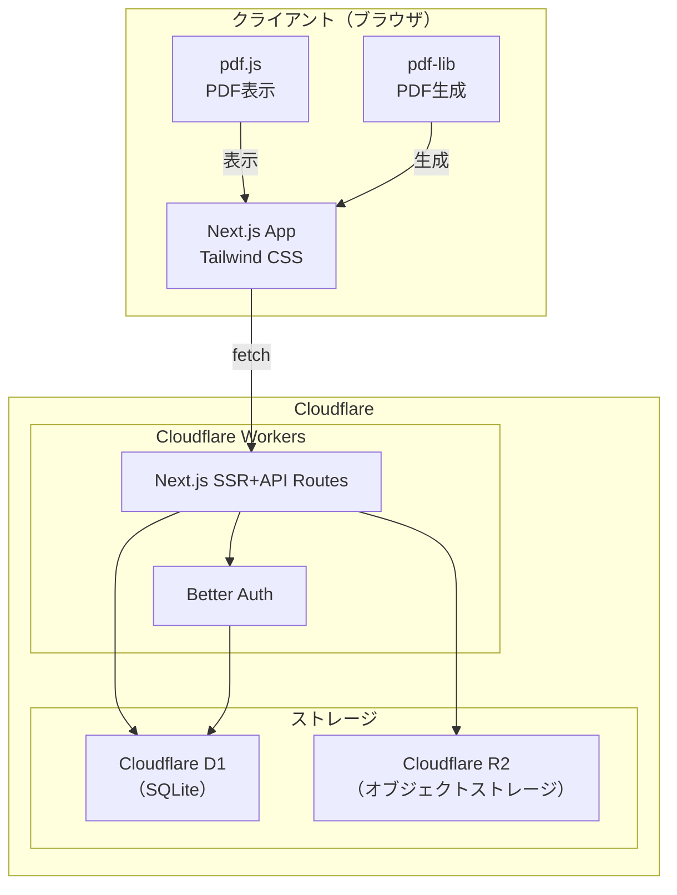
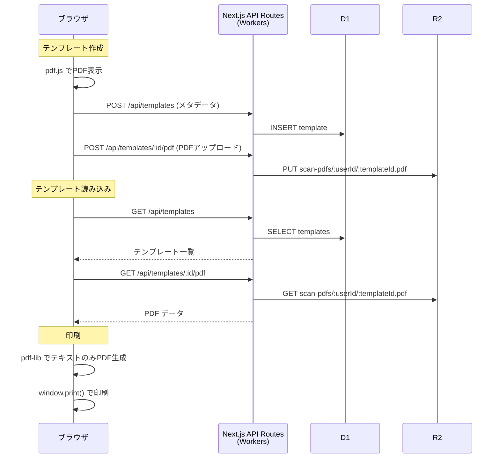
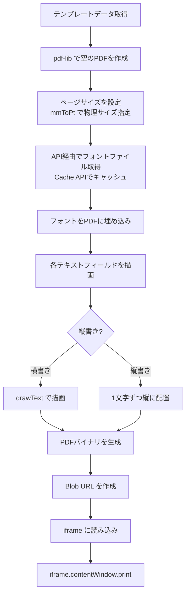

# さくっと印字（sakutto-inji）開発計画書

## 1. プロジェクト概要

### 解決する課題

郵便局の払込取扱票、企業指定の記入用紙、その他定型フォームなど、毎回同じ内容を手書きで記入する作業は非効率で、書き損じのリスクもある。特に定期的に同じ用紙に記入する場合、その手間は大きい。

### アプリの目的

記入用紙をスキャンしてPDFとして取り込み、画面上でテキスト配置位置を指定し、ブランクの実物用紙に直接印字できるWebアプリケーション。作成したテンプレートは保存・再利用が可能。

### 主要機能一覧

| # | 機能 | 説明 |
|---|------|------|
| 1 | PDF読み込み・表示 | スキャンPDFをアップロードし、画面上に背景として表示 |
| 2 | 用紙サイズ設定 | 物理サイズ（mm）の入力。プリセット（A4, B5, はがき等）対応 |
| 3 | テキストフィールド配置 | 用紙上の任意位置にクリックでテキストフィールドを配置 |
| 4 | テキスト書式設定 | フォントサイズ・種類・配置方向（横書き/縦書き）・フィールド幅 |
| 5 | テンプレート保存・管理 | 名前をつけて保存、一覧・検索・複製・編集・削除 |
| 6 | 印刷用PDF生成 | テキストのみ（背景なし）で物理サイズに正確な PDF を生成 |
| 7 | 印刷ガイダンス | 用紙セット方向の図解・設定案内・印刷設定メモの保存 |
| 8 | エクスポート/インポート | テンプレートデータのJSON形式でのバックアップ・復元 |
| 9 | ユーザー認証 | Better Authによるユーザー認証とデータ分離 |
| 10 | PWA対応 | ホーム画面追加に対応 |

---

## 2. 技術アーキテクチャ

### 設計方針（決定事項）

- **APIは Next.js API Routes を使用**（Honoは不採用）
  - 同一オリジンで動作するためCORS問題が発生しない
  - デプロイが1つで済み管理が簡単
  - `@opennextjs/cloudflare` の `getCloudflareContext` 経由で D1/R2 に直接アクセス可能
- **フォントはサブセット化せず、ブラウザキャッシュで対応**
  - 初回のみ約5MBのダウンロードが発生するが、2回目以降はキャッシュから読み込み
  - 速度が問題になった場合にサブセット化を検討（無料ツールで可能）
- **PC専用アプリとして設計**（スマホ対応は行わない）
- **認証は Better Auth で着手し、問題が出たら NextAuth.js (Auth.js) に切替**

### 全体構成図



### 各レイヤーの責務

| レイヤー | 技術 | 責務 |
|---------|------|------|
| フロントエンド | Next.js (App Router) + Tailwind CSS | UI表示、PDF表示・生成（クライアントサイド）、印刷制御 |
| API | Next.js API Routes | REST API、D1/R2アクセス（`getCloudflareContext` 経由） |
| 認証 | Better Auth | ユーザー登録・ログイン・セッション管理 |
| DB | Cloudflare D1 + Drizzle ORM | テンプレートメタデータ、テキストフィールド配置情報、ユーザー情報 |
| ストレージ | Cloudflare R2 | スキャンPDF原本・フォントファイルの保存 |
| ホスティング | Cloudflare Workers | @opennextjs/cloudflare 経由で単一Workerとしてデプロイ |

### 通信フロー



---

## 3. ライブラリ選定

### PDF読み込み・レンダリング

| ライブラリ | 選定 | 理由 |
|-----------|------|------|
| **pdf.js (pdfjs-dist)** | 採用 | Mozilla製の定番PDFレンダリングライブラリ。Canvas/SVGへのレンダリングに対応。ページサイズメタデータの取得も可能。 |

### PDF生成

| ライブラリ | 選定 | 理由 |
|-----------|------|------|
| **pdf-lib** | 採用 | ブラウザ上でPDFを生成可能。ページサイズの自由な指定、フォント埋め込みに対応。TypeScript対応。jsPDFよりカスタムページサイズの扱いが容易。 |

### フォント

| ライブラリ/リソース | 用途 |
|-------------------|------|
| **Noto Sans JP** | ゴシック体（Google Fonts / フォントファイル埋め込み） |
| **Noto Serif JP** | 明朝体（Google Fonts / フォントファイル埋め込み） |

- Web画面表示: Google Fonts CDN から読み込み
- PDF生成時: フォントファイル（.ttf）をR2に保存し、pdf-libで埋め込み
- **フォントはサブセット化せず、ブラウザキャッシュ（Cache API）で対応**
  - 初回ダウンロード: 約5MB/フォント
  - 2回目以降: キャッシュから即座に読み込み
  - 速度が問題になった場合: fonttools（無料Python製ツール）でサブセット化を導入

### その他主要ライブラリ

| ライブラリ | 用途 | 選定理由 |
|-----------|------|---------|
| **Drizzle ORM** | D1操作 | Cloudflare D1との相性が良い。型安全なスキーマ定義。 |
| **Better Auth** | 認証 | Next.jsに公式対応。D1はSQLite互換のためSQLiteアダプターが使える。問題発生時はNextAuth.js (Auth.js) に切替。 |
| **@opennextjs/cloudflare** | Next.jsデプロイ | Next.js App RouterをCloudflare Workers上で動作させるためのアダプター |
| **react-draggable** or カスタム実装 | テキストフィールドのドラッグ配置 | フィールドのドラッグ&ドロップ移動に使用。要件がシンプルなためカスタム実装も検討 |

---

## 4. データモデル設計

### D1 テーブル定義（Drizzleスキーマイメージ）

```typescript
// db/schema.ts
import { sqliteTable, text, integer, real } from "drizzle-orm/sqlite-core";

// ※ Better Auth が管理するテーブル（users, sessions, accounts, verifications等）は
//   Better Auth の初期化時に自動作成される。
//   以下はアプリ固有のテーブルのみ定義。
//   Better Auth のテーブル構造は公式ドキュメントに従うこと。

// テンプレートテーブル
export const templates = sqliteTable("templates", {
  id: text("id").primaryKey(), // UUID
  userId: text("user_id").notNull().references(() => users.id),
  name: text("name").notNull(),                // テンプレート名（例: "ゆうちょ払込取扱票_家賃"）
  paperWidthMm: real("paper_width_mm").notNull(),  // 用紙幅（mm）
  paperHeightMm: real("paper_height_mm").notNull(), // 用紙高さ（mm）
  paperPreset: text("paper_preset"),            // プリセット名（"A4", "B5", "hagaki", "custom"等）
  scanPdfKey: text("scan_pdf_key"),             // R2のオブジェクトキー
  printSettingsNote: text("print_settings_note"), // 印刷設定メモ（ユーザーが成功した設定を記録）
  createdAt: text("created_at").notNull().default("datetime('now')"),
  updatedAt: text("updated_at").notNull().default("datetime('now')"),
});

// テキストフィールドテーブル
export const textFields = sqliteTable("text_fields", {
  id: text("id").primaryKey(), // UUID
  templateId: text("template_id").notNull().references(() => templates.id, { onDelete: "cascade" }),
  label: text("label"),                        // フィールドラベル（例: "金額", "宛名"）
  content: text("content").notNull().default(""), // テキスト内容
  positionXMm: real("position_x_mm").notNull(),   // X座標（mm）- 左上基準
  positionYMm: real("position_y_mm").notNull(),   // Y座標（mm）- 左上基準
  widthMm: real("width_mm"),                      // フィールド幅（mm）- nullは自動
  fontSize: real("font_size").notNull().default(12), // フォントサイズ（pt）
  fontFamily: text("font_family").notNull().default("noto-sans-jp"), // フォント種類
  direction: text("direction").notNull().default("horizontal"), // "horizontal" | "vertical"
  sortOrder: integer("sort_order").notNull().default(0), // 表示順
  createdAt: text("created_at").notNull().default("datetime('now')"),
  updatedAt: text("updated_at").notNull().default("datetime('now')"),
});
```

### R2 オブジェクト構造

```
sakutto-inji-r2/
├── scan-pdfs/
│   └── {userId}/
│       └── {templateId}.pdf          # スキャンPDF原本
└── fonts/
    ├── NotoSansJP-Regular.ttf         # フルフォント（サブセット化なし）
    ├── NotoSansJP-Bold.ttf
    ├── NotoSerifJP-Regular.ttf
    └── NotoSerifJP-Bold.ttf
```

### エクスポート用JSONフォーマット

```json
{
  "version": "1.0",
  "exportedAt": "2026-03-09T00:00:00Z",
  "template": {
    "name": "ゆうちょ払込取扱票_家賃",
    "paperWidthMm": 80,
    "paperHeightMm": 140,
    "paperPreset": "custom",
    "printSettingsNote": "Canon TS3530: 後トレイ手差し、用紙サイズ80x140mm、余白なし"
  },
  "textFields": [
    {
      "label": "金額",
      "content": "50000",
      "positionXMm": 20.5,
      "positionYMm": 35.0,
      "widthMm": 40,
      "fontSize": 14,
      "fontFamily": "noto-sans-jp",
      "direction": "horizontal",
      "sortOrder": 0
    }
  ],
  "scanPdf": "<Base64エンコードされたPDFデータ（オプション）>"
}
```

- `scanPdf` フィールドはエクスポート時にユーザーが「スキャンPDFを含める」を選択した場合のみ付与
- インポート時に `scanPdf` があれば R2 に保存

---

## 5. API設計

### ベースURL

```
https://sakutto-inji.{account}.workers.dev
```

※Next.js API Routesを使用するため、フロントエンドと同一ドメイン。

### エンドポイント一覧

#### 認証（Better Auth）

| メソッド | パス | 説明 |
|---------|------|------|
| POST | `/api/auth/sign-up` | ユーザー登録 |
| POST | `/api/auth/sign-in` | ログイン |
| POST | `/api/auth/sign-out` | ログアウト |
| GET | `/api/auth/session` | セッション確認 |

#### テンプレート

| メソッド | パス | 説明 | リクエスト | レスポンス |
|---------|------|------|-----------|-----------|
| GET | `/api/templates` | テンプレート一覧取得 | クエリ: `?q=検索語&sort=updated_at&order=desc` | `{ templates: Template[] }` |
| GET | `/api/templates/:id` | テンプレート詳細取得 | - | `{ template: Template, textFields: TextField[] }` |
| POST | `/api/templates` | テンプレート作成 | `{ name, paperWidthMm, paperHeightMm, paperPreset }` | `{ template: Template }` |
| PUT | `/api/templates/:id` | テンプレート更新 | `{ name?, paperWidthMm?, paperHeightMm?, printSettingsNote? }` | `{ template: Template }` |
| DELETE | `/api/templates/:id` | テンプレート削除 | - | `{ success: true }` |
| POST | `/api/templates/:id/duplicate` | テンプレート複製 | `{ name }` | `{ template: Template }` |

#### テキストフィールド

| メソッド | パス | 説明 | リクエスト | レスポンス |
|---------|------|------|-----------|-----------|
| PUT | `/api/templates/:id/fields` | フィールド一括更新 | `{ fields: TextField[] }` | `{ fields: TextField[] }` |

- テキストフィールドはテンプレート編集画面で一括保存する設計（個別CRUD は不要）

#### スキャンPDF

| メソッド | パス | 説明 | リクエスト | レスポンス |
|---------|------|------|-----------|-----------|
| POST | `/api/templates/:id/pdf` | スキャンPDFアップロード | `multipart/form-data { file }`（上限10MB） | `{ scanPdfKey: string }` |
| GET | `/api/templates/:id/pdf` | スキャンPDF取得 | - | `application/pdf` (バイナリ) |
| DELETE | `/api/templates/:id/pdf` | スキャンPDF削除 | - | `{ success: true }` |

**PDFアップロード制限**:
- アップロード前にクライアントサイドでPDFの自動圧縮を実行（Canvas経由で画質を下げて再PDF化）
- 圧縮後も10MBを超える場合はエラーを表示し、「スキャン解像度を150〜200dpiに下げて再スキャンしてください」とガイド表示
- Cloudflare Workers Freeプランのリクエスト上限（100MB）の範囲内で十分

#### エクスポート/インポート

| メソッド | パス | 説明 | リクエスト | レスポンス |
|---------|------|------|-----------|-----------|
| GET | `/api/templates/:id/export` | テンプレートエクスポート | クエリ: `?includePdf=true` | `application/json` (ダウンロード) |
| POST | `/api/templates/import` | テンプレートインポート | `multipart/form-data { file }` | `{ template: Template }` |

#### フォント

| メソッド | パス | 説明 | レスポンス |
|---------|------|------|-----------|
| GET | `/api/fonts` | 利用可能フォント一覧 | `{ fonts: Font[] }` |
| GET | `/api/fonts/:key` | フォントファイル取得 | `font/ttf` (バイナリ)。`Cache-Control: public, max-age=31536000` ヘッダー付き |

---

## 6. 画面設計

### 画面一覧

| # | 画面名 | パス | 役割 |
|---|--------|------|------|
| 1 | ログイン画面 | `/login` | ユーザー認証 |
| 2 | ユーザー登録画面 | `/register` | 新規ユーザー登録 |
| 3 | テンプレート一覧画面 | `/` (ホーム) | テンプレートの一覧表示・検索・管理 |
| 4 | テンプレート作成画面 | `/templates/new` | PDF読み込み・用紙サイズ設定・新規作成 |
| 5 | テンプレート編集画面 | `/templates/:id/edit` | テキストフィールドの配置・編集（メイン画面） |
| 6 | 印刷プレビュー画面 | `/templates/:id/print` | 印刷前のプレビュー・ガイダンス・印刷実行 |

※PC専用アプリとして設計。最小画面幅は1024pxを想定。

### PC専用の案内設計

スマホ・小画面端末でアクセスした場合（画面幅1024px未満）、アプリ本体のUIは表示せず、代わりに以下のような案内画面を全面表示する:

```
┌──────────────────────┐
│                      │
│    さくっと印字       │
│                      │
│  このアプリはPC専用   │
│  です。画面幅1024px  │
│  以上のPC環境から     │
│  アクセスしてくださ   │
│  い。                │
│                      │
│  テキスト配置・印刷   │
│  設定にはマウス操作   │
│  と大きな画面が必要   │
│  です。              │
│                      │
└──────────────────────┘
```

- `layout.tsx`でviewportのmetaタグを通常通り設定（レスポンシブ無効化はしない）
- CSSメディアクエリ `@media (max-width: 1023px)` でアプリ本体を非表示にし、案内を表示
- 案内コンポーネント `DeviceGate.tsx` として実装

### 主要画面の説明

#### テンプレート一覧画面 (`/`)

```
┌──────────────────────────────────────────┐
│  さくっと印字              [ユーザー名 ▼] │
├──────────────────────────────────────────┤
│  [テンプレートを検索...]     [＋ 新規作成]  │
│                                          │
│  ┌────────────┐  ┌────────────┐          │
│  │ 払込取扱票  │  │ 入会申込書  │          │
│  │  _家賃     │  │            │          │
│  │            │  │            │          │
│  │ 更新: 3/8  │  │ 更新: 3/5  │          │
│  │ [編集][印刷]│  │ [編集][印刷]│          │
│  │ [...]      │  │ [...]      │          │
│  └────────────┘  └────────────┘          │
│                                          │
│  [インポート]                              │
└──────────────────────────────────────────┘
```

- カード形式でテンプレートを一覧表示
- 各カードにはテンプレート名、最終更新日
- `[...]` メニューから複製・エクスポート・削除が可能

#### テンプレート作成画面 (`/templates/new`)

```
┌──────────────────────────────────────────┐
│  ← 戻る    新しいテンプレート              │
├──────────────────────────────────────────┤
│                                          │
│  テンプレート名: [                    ]    │
│                                          │
│  --- スキャンPDF ---                      │
│  [PDFファイルを選択]                       │
│  またはドラッグ&ドロップ                    │
│  ※ 10MB以下のPDFファイル                   │
│                                          │
│  --- 用紙サイズ ---                       │
│  プリセット: [v カスタム          ]        │
│    A4 (210x297mm)                        │
│    B5 (182x257mm)                        │
│    はがき (100x148mm)                     │
│    払込取扱票 (80x140mm)                  │
│    カスタム                               │
│                                          │
│  幅: [  80 ] mm  高さ: [ 140 ] mm        │
│                                          │
│  [作成して編集画面へ →]                    │
└──────────────────────────────────────────┘
```

#### テンプレート編集画面 (`/templates/:id/edit`) --- メイン画面

```
┌──────────────────────────────────────────────────────────┐
│  ← 一覧   払込取扱票_家賃        [保存] [印刷プレビュー →] │
├─────────────────────────────┬────────────────────────────┤
│                             │  --- フィールド一覧 ---     │
│                             │                            │
│   ┌─────────────────────┐   │  (1) 金額                  │
│   │ (スキャンPDF背景)     │   │    [50000          ]      │
│   │                     │   │    サイズ: [14]pt           │
│   │    ┌──────┐         │   │    フォント: [v ゴシック]    │
│   │    │50000 │←(1)     │   │    方向: [横書き v]         │
│   │    └──────┘         │   │    幅: [40]mm              │
│   │                     │   │    [x削除]                  │
│   │         ┌──┐        │   │                            │
│   │         │山│←(2)    │   │  (2) 名前                  │
│   │         │田│        │   │    [山田太郎       ]        │
│   │         │太│        │   │    サイズ: [12]pt           │
│   │         │郎│        │   │    フォント: [v 明朝]       │
│   │         └──┘        │   │    方向: [縦書き v]         │
│   │                     │   │                            │
│   └─────────────────────┘   │  [＋ フィールドを追加]       │
│                             │  ※用紙上をクリックでも追加可  │
│   [-] ─────●───── [+]      │                            │
│         ズーム 100%          │                            │
├─────────────────────────────┴────────────────────────────┤
│  用紙: 80mm x 140mm (カスタム)                            │
└──────────────────────────────────────────────────────────┘
```

- 左ペイン: スキャンPDFを背景にした用紙プレビュー。クリックでフィールド追加、ドラッグで移動
- 右ペイン: フィールド一覧と各フィールドのプロパティ編集
- 下部: ズームスライダー、用紙情報

#### 印刷プレビュー画面 (`/templates/:id/print`)

```
┌──────────────────────────────────────────────────────────┐
│  ← 編集に戻る    印刷プレビュー                [印刷する]  │
├──────────────────────────────┬───────────────────────────┤
│                              │  --- 印刷ガイド ---       │
│   ┌──────────────────────┐   │                          │
│   │ (テキストのみ表示)     │   │  用紙セット手順           │
│   │                      │   │                          │
│   │     50000            │   │  1. プリンターの後トレイ     │
│   │                      │   │     （手差し）を開く       │
│   │          山           │   │                          │
│   │          田           │   │  2. 用紙を下図の向きで     │
│   │          太           │   │     セットする            │
│   │          郎           │   │                          │
│   │                      │   │     ┌────┐               │
│   │                      │   │     │ 表 │               │
│   └──────────────────────┘   │     │    │               │
│                              │     └────┘               │
│   背景を重ねて確認:           │                          │
│   [ ] スキャン画像を表示      │  3. 用紙サイズを           │
│                              │     「ユーザー定義」で      │
│                              │     80mm x 140mm に設定   │
│                              │                          │
│                              │  4. 余白を「なし」に設定    │
│                              │                          │
│                              │  ※ 初回は普通紙でテスト    │
│                              │    印刷を推奨します        │
│                              │                          │
│                              │  --- 印刷設定メモ ---     │
│                              │  [自由入力テキストエリア]   │
│                              │  例: Canon TS3530:       │
│                              │  後トレイ手差し、余白なし   │
│                              │  [メモを保存]             │
└──────────────────────────────┴───────────────────────────┘
```

- 「印刷設定メモ」欄でユーザーがうまくいった印刷設定を自由記述で保存可能
- 次回同じテンプレートを印刷する際にメモが表示される

---

## 7. PDF座標系の設計

### 単位系

| 単位 | 用途 | 基準 |
|------|------|------|
| mm（ミリメートル） | 物理サイズの基準単位。ユーザー入力・DB保存 | 物理寸法 |
| pt（ポイント） | PDF内部単位。1pt = 1/72 inch = 0.3528mm | PDFの座標系 |
| px（ピクセル） | 画面表示用。表示倍率に依存 | 画面表示 |

### 変換ロジック

```typescript
// 定数
const MM_PER_INCH = 25.4;
const PT_PER_INCH = 72;
const MM_TO_PT = PT_PER_INCH / MM_PER_INCH; // ≈ 2.8346

// mm → pt（PDF生成時に使用）
function mmToPt(mm: number): number {
  return mm * MM_TO_PT;
}

// pt → mm
function ptToMm(pt: number): number {
  return pt / MM_TO_PT;
}

// mm → px（画面表示時に使用）
// baseDpi: 画面上で1mmを何pxで表示するかの基準値
function mmToPx(mm: number, zoom: number, baseDpi: number = 3.78): number {
  return mm * baseDpi * zoom;
}

// px → mm（画面クリック位置をmm座標に変換）
function pxToMm(px: number, zoom: number, baseDpi: number = 3.78): number {
  return px / (baseDpi * zoom);
}
```

### 座標原点

- **画面表示**: 用紙の左上が原点 (0, 0)、右方向が+X、下方向が+Y
- **PDF座標系**: pdf-libは左下が原点のため、Y座標を反転する必要あり
  ```typescript
  // 画面座標(mm) → PDF座標(pt) の変換
  function toPagePdfCoords(xMm: number, yMm: number, pageHeightMm: number) {
    return {
      x: mmToPt(xMm),
      y: mmToPt(pageHeightMm - yMm), // Y軸反転
    };
  }
  ```

### 画面表示と印刷出力の座標一致の担保

1. **DB保存はmm単位**: 全ての座標・サイズはmm単位で保存。表示倍率に依存しない。
2. **用紙サイズの正確な指定**: pdf-libで生成するPDFのページサイズを `mmToPt(widthMm) x mmToPt(heightMm)` で指定。
3. **フォントサイズ**: pt単位で保存・使用。画面表示時のみズーム倍率を適用。
4. **検証方法**: A4用紙等の既知サイズで、特定座標に文字を配置し、実際に印刷して定規で計測。

---

## 8. 印刷機能の設計

### 印刷用PDF生成フロー



### 実装方針

1. **PDF生成はクライアントサイドで実行**: pdf-libはブラウザで動作するため、サーバー負荷なし
2. **テキストのみ出力**: スキャンPDF背景は含めない。テキストフィールドのデータのみでPDFを構成
3. **フォント埋め込み**:
   - R2からフォントファイル（.ttf）をAPI経由で取得
      - pdf-libの`embedFont()`でPDFに埋め込み
   - フォントはブラウザのCache APIでキャッシュ（`Cache-Control: public, max-age=31536000`）

### 縦書き対応方針

pdf-libには縦書き用APIがないため、以下の方法で実装:
- 1文字ずつY座標をずらして配置
- フォントサイズ分（+ 行間）ずつ下にオフセット
- 句読点・小書き文字（っ、ゃ等）は位置を微調整するマッピングテーブルを用意
- 画面表示は CSS `writing-mode: vertical-rl` で対応

### 用紙セットガイダンスの実装方針

- テンプレートの用紙サイズに応じて、セット方向（縦/横）を自動判定
- プリセット用紙にはデフォルトのセット方向を定義
- カスタムサイズは「縦長なら縦向き」等のデフォルト + ユーザー設定可能
- ガイダンスは静的なイラスト/テキストで表示（プリンターモデルごとの差異には対応しない）
- **印刷設定メモ機能**: ユーザーがテスト印刷で成功した設定を自由記述で保存。次回表示時にメモが表示される

### ブラウザ印刷の制約と対処法

| 制約 | 対処法 |
|------|--------|
| `window.print()` ではPDFの用紙サイズを直接指定できない | pdf-lib で正確なサイズのPDFを生成し、印刷ダイアログで「実際のサイズ」を選択するようガイド |
| カスタム用紙サイズ（払込取扱票等）はOS/プリンター設定が必要 | ガイダンス画面でカスタム用紙サイズの設定方法を案内 |
| ブラウザが自動的に余白を追加する場合がある | ガイダンスで「余白: なし」設定を案内。CSS `@page { margin: 0 }` も併用 |
| 印刷の拡大/縮小 | 「100%（実際のサイズ）」で印刷するよう案内 |
| プリンターごとの印刷マージンの差異 | 将来的に位置微調整機能（X/Yオフセット設定）を検討 |

### 印刷用CSS

```css
@media print {
  /* 印刷時はガイダンスUI等を非表示 */
  .no-print {
    display: none !important;
  }

  @page {
    margin: 0;
    /* サイズはPDF側で制御するため、ここでは指定しない */
  }
}
```

---

## 9. 実装フェーズ分け

### Phase 1: プロジェクト初期化・基盤構築

**目標**: 開発環境のセットアップ、認証機能、基本的なページ遷移が動作する状態

**作成するファイル・設定**:

```
sakutto-inji/
├── .dev.vars                          # ローカル環境変数
├── .gitignore
├── wrangler.toml                      # Cloudflare Workers設定
├── package.json
├── tsconfig.json
├── next.config.ts
├── tailwind.config.ts
├── drizzle.config.ts
│
├── db/
│   └── schema.sql                     # D1スキーマ（CREATE TABLE文）
│
├── src/
│   ├── app/
│   │   ├── layout.tsx                 # ルートレイアウト（フォント、PWA設定）
│   │   ├── page.tsx                   # ホーム（Phase 1では認証後リダイレクトのみ。一覧UIはPhase 4で実装）
│   │   ├── login/
│   │   │   └── page.tsx               # ログイン画面
│   │   ├── register/
│   │   │   └── page.tsx               # ユーザー登録画面
│   │   ├── api/
│   │   │   └── auth/
│   │   │       └── [...all]/
│   │   │           └── route.ts       # Better Auth ハンドラー
│   │   └── globals.css                # グローバルCSS
│   │
│   ├── lib/
│   │   ├── auth.ts                    # Better Auth サーバー設定
│   │   ├── auth-client.ts             # Better Auth クライアント設定
│   │   └── db.ts                      # D1接続ヘルパー（getCloudflareContext）
│   │
│   └── components/
│       ├── DeviceGate.tsx             # PC専用案内（画面幅1024px未満で表示）
│       ├── Header.tsx                 # ヘッダー（認証状態表示）
│       └── AuthForm.tsx               # ログイン/登録フォーム
│
└── public/
    ├── manifest.json                  # PWAマニフェスト
    └── icon.png                       # アプリアイコン
```

**実装する機能**:
- Next.js + Tailwind CSS プロジェクト初期化
- @opennextjs/cloudflare 設定
- wrangler.tomlにD1/R2バインディング設定
- D1データベース作成・スキーマ適用
- Better Authによるユーザー登録・ログイン・ログアウト（D1のSQLiteアダプター使用）
- 認証ミドルウェア（保護されたAPIルートの設定）
- 基本的なページレイアウト（ヘッダー、ナビゲーション）
- PC専用案内コンポーネント（DeviceGate: 画面幅1024px未満でアプリ本体を非表示にし案内を表示）
- PWAマニフェスト設定
- ローカル開発環境の構築（`npm run cf:build` → `npx wrangler dev`）

### Phase 2: PDF読み込み・表示・テキスト配置のコア機能

**目標**: スキャンPDFを背景に表示し、テキストフィールドを配置・編集できる

**作成するファイル**:

```
src/
├── app/
│   ├── templates/
│   │   ├── new/
│   │   │   └── page.tsx               # テンプレート作成画面
│   │   └── [id]/
│   │       └── edit/
│   │           └── page.tsx           # テンプレート編集画面
│   └── api/
│       └── templates/
│           ├── route.ts               # GET（一覧）, POST（作成）
│           └── [id]/
│               ├── route.ts           # GET, PUT, DELETE
│               ├── fields/
│               │   └── route.ts       # PUT（フィールド一括更新）
│               └── pdf/
│                   └── route.ts       # POST（アップロード）, GET（取得）, DELETE
│
├── components/
│   ├── PdfViewer.tsx                  # pdf.js によるPDF表示コンポーネント
│   ├── PaperCanvas.tsx                # 用紙キャンバス（PDF背景 + フィールド重畳）
│   ├── TextField.tsx                  # ドラッグ可能なテキストフィールド
│   ├── TextFieldPanel.tsx             # フィールドプロパティ編集パネル
│   ├── PaperSizeSelector.tsx          # 用紙サイズ選択（プリセット + カスタム）
│   ├── PdfUploader.tsx                # PDFアップロードコンポーネント（圧縮処理含む）
│   └── ZoomControl.tsx                # ズームコントロール
│
├── lib/
│   ├── pdf-renderer.ts                # pdf.js ラッパー（PDF読み込み・Canvas描画）
│   ├── pdf-compressor.ts              # PDFクライアントサイド圧縮（Canvas経由で画質を下げて再PDF化）
│   ├── coordinates.ts                 # 座標変換ユーティリティ（mm↔px↔pt）
│   └── paper-presets.ts               # 用紙サイズプリセット定義
│
└── hooks/
    ├── useTextFields.ts               # テキストフィールド状態管理
    └── usePdfViewer.ts                # PDF表示制御
```

**実装する機能**:
- PDFファイルアップロード → クライアントサイド自動圧縮（Canvas経由で画質を下げて再PDF化）→ 10MB上限バリデーション → R2保存
- pdf.jsによるPDFのCanvas描画
- PDFメタデータからのページサイズ取得（mm換算）
- 用紙サイズプリセット選択 + カスタム入力
- 用紙上のクリックでテキストフィールド追加
- テキストフィールドのドラッグ移動
- フォントサイズ・種類・方向の設定UI
- ズーム表示（拡大/縮小）
- テンプレートのCRUD API（Next.js API Routes + D1）

### Phase 3: 印刷用PDF生成・印刷機能

**目標**: テキストのみの印刷用PDFを生成し、ブラウザから印刷できる

**作成するファイル**:

```
src/
├── app/
│   ├── templates/
│   │   └── [id]/
│   │       └── print/
│   │           └── page.tsx           # 印刷プレビュー・ガイダンス画面
│   └── api/
│       └── fonts/
│           ├── route.ts               # GET（フォント一覧）
│           └── [key]/
│               └── route.ts           # GET（フォントファイル取得、キャッシュヘッダー付き）
│
├── components/
│   ├── PrintPreview.tsx               # 印刷プレビュー表示
│   ├── PrintGuide.tsx                 # 用紙セットガイダンス
│   ├── PrintSettingsNote.tsx          # 印刷設定メモ編集・表示
│   └── PrintButton.tsx                # 印刷実行ボタン
│
└── lib/
    ├── pdf-generator.ts               # pdf-lib によるPDF生成
    ├── font-loader.ts                 # フォントファイル読み込み・キャッシュ（Cache API）
    └── print.ts                       # 印刷実行ユーティリティ
```

**実装する機能**:
- pdf-libによるテキストのみPDF生成
  - カスタムページサイズ（mm → pt変換）
  - フォント埋め込み（Noto Sans JP / Noto Serif JP）
  - テキスト配置（座標変換）
- 印刷プレビュー画面（テキストのみ表示 / 背景重畳切替）
- 印刷ガイダンスUI（用紙セット方向、設定案内）
- 印刷設定メモの保存・表示機能
- `window.print()` による印刷実行
- `@media print` CSS設定
- フォントファイルのR2保存・配信API（長期キャッシュヘッダー付き）
- フォントのブラウザキャッシュ（Cache API）

### Phase 4: テンプレート保存・一覧・管理（R2連携含む）

**目標**: テンプレートの完全な管理機能（一覧・検索・複製・削除）

**作成するファイル**:

```
src/
├── app/
│   └── api/
│       └── templates/
│           └── [id]/
│               └── duplicate/
│                   └── route.ts       # POST（テンプレート複製）
│
├── components/
│   ├── TemplateList.tsx               # テンプレート一覧
│   ├── TemplateCard.tsx               # テンプレートカード
│   ├── TemplateSearch.tsx             # 検索・フィルタ
│   ├── TemplateMenu.tsx               # コンテキストメニュー（複製/削除等）
│   └── ConfirmDialog.tsx              # 確認ダイアログ
│
└── hooks/
    └── useTemplates.ts                # テンプレート一覧の状態管理
```

**実装する機能**:
- テンプレート一覧画面（カード形式表示）
- テンプレート検索（名前での絞り込み）
- テンプレート並び替え（更新日順、名前順）
- テンプレートの複製（R2のPDFもコピー）
- テンプレートの削除（確認ダイアログ付き、R2のPDFも削除）
- テンプレート名の編集
- テキスト内容の編集後即座保存（印刷フロー時）

### Phase 5: エクスポート/インポート・UX改善・縦書き対応等

**目標**: 仕上げ機能の実装とUX向上

**作成するファイル**:

```
src/
├── app/
│   └── api/
│       └── templates/
│           ├── import/
│           │   └── route.ts           # POST（インポート）
│           └── [id]/
│               └── export/
│                   └── route.ts       # GET（エクスポート）
│
├── components/
│   ├── ExportDialog.tsx               # エクスポート設定ダイアログ
│   ├── ImportDialog.tsx               # インポートダイアログ
│   └── VerticalText.tsx               # 縦書きテキスト表示コンポーネント
│
└── lib/
    ├── export.ts                      # テンプレートエクスポート処理
    ├── import.ts                      # テンプレートインポート処理
    └── vertical-text.ts              # 縦書きテキスト処理（PDF生成用）
```

**実装する機能**:
- テンプレートエクスポート（JSONダウンロード、PDF含有オプション）
- テンプレートインポート（JSONファイル読み込み、バリデーション）
- 縦書きテキスト対応
  - 画面表示: CSS `writing-mode: vertical-rl`
  - PDF生成: 1文字ずつ縦に配置する処理（句読点・小書き文字の位置調整含む）
- UX改善
  - フィールド選択時のハイライト・リサイズハンドル
  - キーボードショートカット（Delete、Ctrl+Z、Ctrl+S等）
  - ローディング状態・エラーハンドリング

---

## 10. 未解決の技術課題・リスク

### 調査が必要な事項

| # | 課題 | 詳細 | 優先度 | 方針 |
|---|------|------|--------|------|
| 1 | pdf-lib の縦書き対応 | pdf-libには縦書き用APIがない。1文字ずつY座標をずらして配置する実装が必要。句読点・小書き文字の位置調整も必要。 | 中（Phase 5） | 横書きを先に完成させ、縦書きはPhase 5で実装。1文字ずつ配置 + 句読点マッピングテーブルで対応。 |
| 2 | pdf.js のWorker設定 | pdf.jsのWeb Worker設定がCloudflare Pages環境で正常に動作するか検証が必要。 | 中（Phase 2） | 動作確認しながら進める。問題があればWorkerなし（メインスレッド）で動作させるフォールバックを用意。 |
| 3 | Better Auth + Next.js + D1 の統合 | Better AuthのNext.jsアダプター + SQLiteアダプターでD1を使う構成。事例は増えつつあるが検証が必要。 | 高（Phase 1） | Better Authで着手。問題が出たらNextAuth.js (Auth.js) v5 + Drizzle アダプターに切替。 |

### 既知の制約・リスク

| # | 制約/リスク | 影響 | 対処方針 |
|---|------------|------|---------|
| 1 | ブラウザの印刷ダイアログの制御不可 | ユーザーが用紙サイズや余白を正しく設定しないと位置がずれる | ガイダンスUIで丁寧に案内。テスト印刷を推奨。成功した印刷設定をメモとして保存可能にする。 |
| 2 | プリンターごとの印刷マージンの差異 | 同じ設定でもプリンターによって微妙に位置がずれる可能性 | 印刷設定メモで対処。将来的にX/Yオフセット微調整機能の追加を検討。 |
| 3 | @opennextjs/cloudflare のWindows対応 | 「WARN OpenNext is not fully compatible with Windows」の警告あり | ビルド・動作に問題なければ無視。問題発生時はWSL2を検討。 |
| 4 | D1のストレージ制限 | Free: 5GB、Paid: 10GB | テンプレートメタデータのみなので十分。PDFはR2に保存。 |
| 5 | R2の無料枠 | 10GB/月のストレージ、Class A 1M ops/月、Class B 10M ops/月 | 個人利用なら十分。 |
| 6 | PDFアップロードサイズ | スキャン解像度が高いとファイルサイズが大きくなる | クライアントサイドで自動圧縮（Canvas経由で再PDF化）。圧縮後も10MB超過時はガイド表示。 |

### 代替案の検討

| 課題 | 現在の方針 | 代替案（問題発生時） |
|------|-----------|-------------------|
| PDF生成 | pdf-lib（クライアントサイド） | jsPDF（クライアントサイド） |
| フォント配信 | R2から配信 + Cache API キャッシュ | CDNから直接取得（ただしpdf-lib埋め込み用にはバイナリが必要） |
| 認証 | Better Auth (Next.js + SQLite) | NextAuth.js (Auth.js) v5 + Drizzle アダプター |
| 縦書き | 1文字ずつ配置 | SVG経由でのPDF埋め込み |

---

## 補足: 開発環境・デプロイ手順

### ローカル開発

参考: skill-cloudflare-local-dev.md

```bash
# 1. 環境変数設定（.dev.vars）
# 2. ローカルD1にスキーマ適用
npx wrangler d1 execute sakutto-inji-db --local --file=db/schema.sql

# 3. ビルド
npm run cf:build

# 4. ローカルサーバー起動
npx wrangler dev
# → http://localhost:8787
```

### 本番デプロイ

参考: skill-cloudflare-deploy.md

```bash
# 初回のみ
npx wrangler d1 create sakutto-inji-db
npx wrangler d1 execute sakutto-inji-db --remote --file=db/schema.sql
npx wrangler secret put AUTH_SECRET

# デプロイ
npm run deploy
```

### PWA設定

参考: skill-pwa-setup.md

- `public/manifest.json` にアプリ情報を定義
- `layout.tsx` の `metadata` にPWA設定を追加
- Cloudflare Workers環境では `next/image` に `unoptimized` が必須

### フォントファイルのR2初期アップロード

```bash
# Noto Sans JP / Noto Serif JP の .ttf ファイルを Google Fonts からダウンロードし、R2にアップロード
npx wrangler r2 object put sakutto-inji-r2/fonts/NotoSansJP-Regular.ttf --file=./fonts/NotoSansJP-Regular.ttf
npx wrangler r2 object put sakutto-inji-r2/fonts/NotoSerifJP-Regular.ttf --file=./fonts/NotoSerifJP-Regular.ttf
# Bold等も同様に必要分アップロード
```

- 初回デプロイ時に手動で実行
- フォントファイルはGoogle FontsのGitHubリポジトリからダウンロード可能

### D1操作パターン

参考: skill-d1-api-patterns.md

- Next.js API Routes内では `getCloudflareContext` 経由で `env.DB` を取得してD1にアクセス
- Drizzle ORMを使う場合は `drizzle(env.DB)` で初期化
- SQLiteの制約に注意: `GREATEST()` → `MAX()`、`datetime('now')` でUTC
- 予約語の回避（`range` → `range_key` 等）
